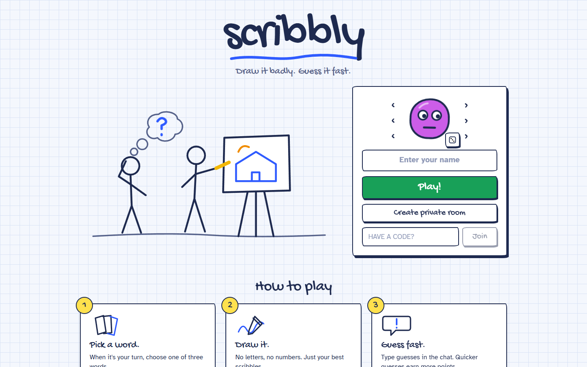
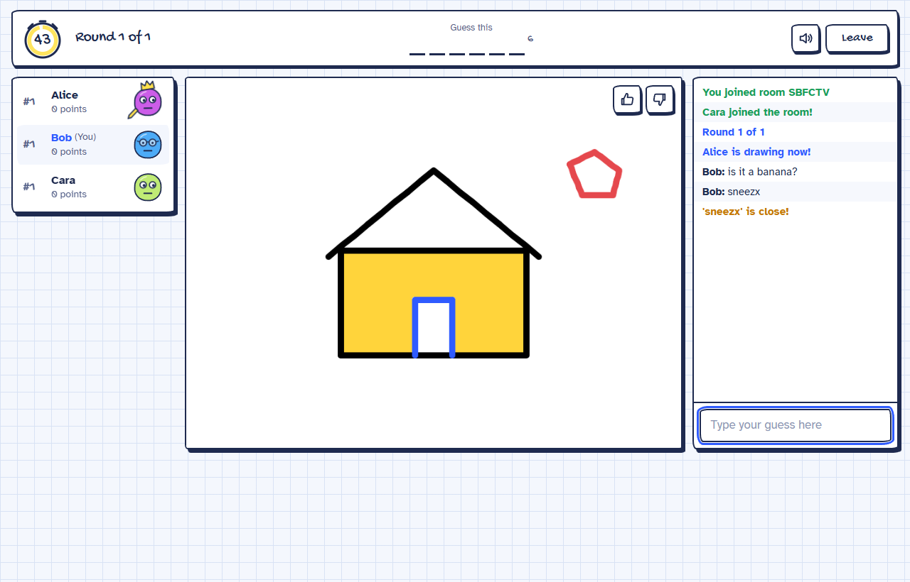
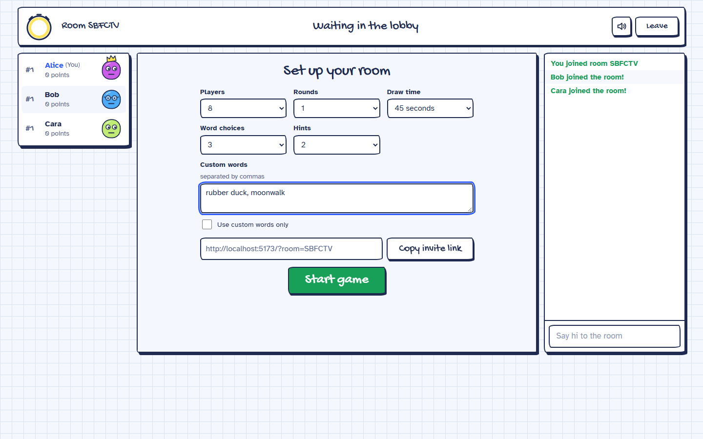
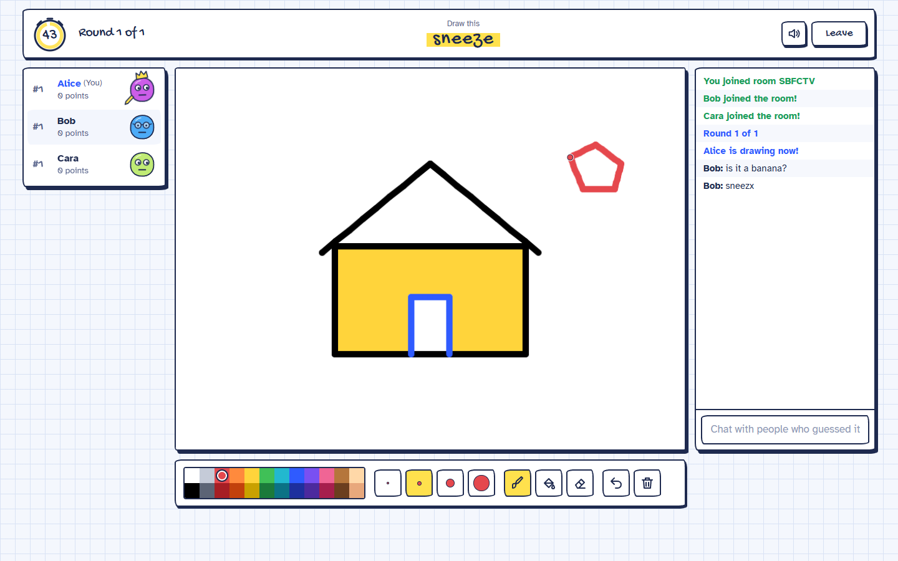
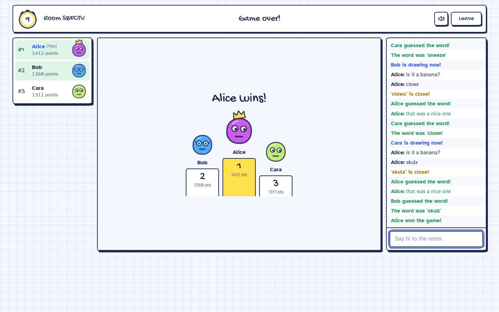

# Scribbly

**Draw it badly. Guess it fast.** A free multiplayer drawing and guessing game for 2 to 12 friends, right in the browser.



## How to play

1. **Pick a word.** When it's your turn, you get a few words to choose from. Pick one within 15 seconds.
2. **Draw it.** No letters, no numbers, just drawing. Everyone else sees your strokes as you make them.
3. **Guess fast.** When someone else is drawing, type your guesses in the chat. The faster you get it, the more points you score.

Everyone draws once per round. After the last round, the player with the most points wins.



## Start a game

- **Play!** puts you in a public room with other players. The game starts as soon as there are two of you.
- **Create private room** gives you a room of your own. Choose the settings, press **Copy invite link**, send it to your friends, then press **Start game** once they're in.
- **Have a code?** Type a friend's 6-letter room code and press **Join**. Opening an invite link works too.

Before you play, type a name and give your character a face with the arrows (or roll the dice for a random one).



### Private room settings

| Setting | What it does |
|---|---|
| Players | How many people can join (2–12) |
| Rounds | How many times everyone draws (1–10) |
| Draw time | Seconds per drawing (30–240) |
| Word choices | How many words the drawer picks from (1–5) |
| Hints | How many letters get revealed while drawing (never more than half the word) |
| Custom words | Your own words, separated by commas, mixed in with the built-in ones |
| Use custom words only | Play only with your words |

## While you draw



| Tool | Shortcut | |
|---|---|---|
| Brush | `B` | Pick a colour and one of four sizes |
| Fill | `F` | Fill an enclosed area with colour |
| Eraser | `E` | Paint white |
| Undo | `Ctrl` + `Z` | Removes your last stroke |
| Clear | | Wipes the board |

You can chat while you draw, but only players who already guessed will see it, and you can't type the word.

## While you guess

- Your word appears as blanks at the top, like `_ _ _ _ _`. Letters fill in as hints over time.
- If your guess is one letter off, you'll see **"… is close!"**. Only you see that.
- Once you've guessed, your chat only goes to the drawer and others who guessed, so you can't spoil it.
- Like or dislike the drawing with the thumbs at the top-right of the board.

## Points

- **Guessers:** up to 500 points. You get more the sooner you guess, plus a bonus for being 1st, 2nd or 3rd.
- **Drawer:** half of every correct guesser's points. The more people who get your drawing, the more you score.

After each turn you see the word and everyone's points. After the last round there's a podium.



## Being a good sport

- **Vote kick:** hover over a player in the list and press **×** to vote them out. It takes at least two votes.
- **Room owners** (the crown) can kick directly in private rooms.
- **Sound:** the speaker button in the top bar turns sound on or off.
- **Leave:** the button in the top bar takes you back to the home page.

Scribbly works on phones too: the board comes first, then the tools, chat and players.

---

## Run it yourself

You need **Java 17+** and **Node.js 20+**.

```bash
# 1. Start the game server (http://localhost:8080)
cd backend/game
./mvnw spring-boot:run          # Windows: mvnw.cmd spring-boot:run

# 2. In a second terminal, start the website
cd frontend
npm install
npm run dev                     # open http://localhost:5173
```

To play with friends on your network, run `npm run dev -- --host` and share the address it prints.

### Configuration

Server settings live in `backend/game/src/main/resources/application.properties`:

| Property | Default | |
|---|---|---|
| `game.choose-seconds` | 15 | Time to pick a word |
| `game.turn-end-seconds` | 6 | How long the word is shown after a turn |
| `game.game-over-seconds` | 10 | How long the podium is shown |
| `game.public-max-players` | 8 | Seats in public rooms |
| `game.allowed-origins` | `*` | Websites allowed to connect. Set this to your domain in production. |

The built-in words are in `backend/game/src/main/resources/static/words.txt`, one per line.

If the website and server run on different hosts, build the site with `VITE_WS_URL=https://your-server/ws npm run build`.

### Tests

```bash
cd backend/game && ./mvnw test   # 35 backend tests, including a real WebSocket game
cd frontend && npm test          # 12 frontend tests
cd frontend && npm run e2e       # plays full games in Chrome (both servers must be running)
```

### For developers

See [documents/](documents/README.md) for the architecture, the WebSocket protocol, the exact game rules, testing and design notes.

Built with Spring Boot 3.5 (Java 17) and Vue 3 + Vite.
