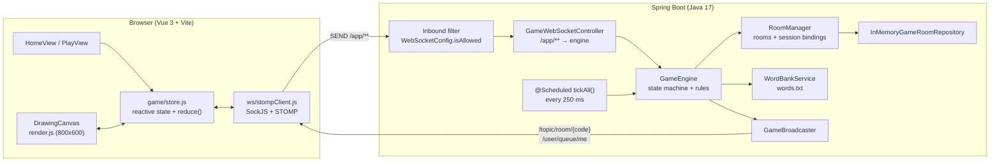
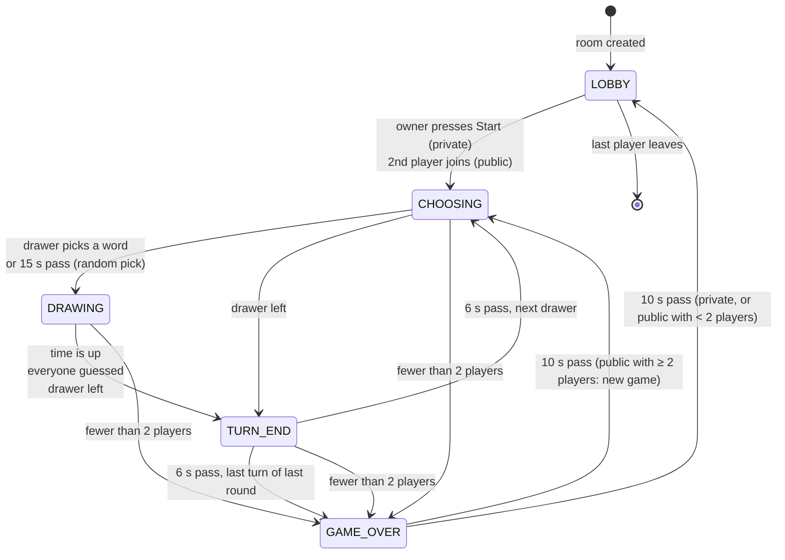
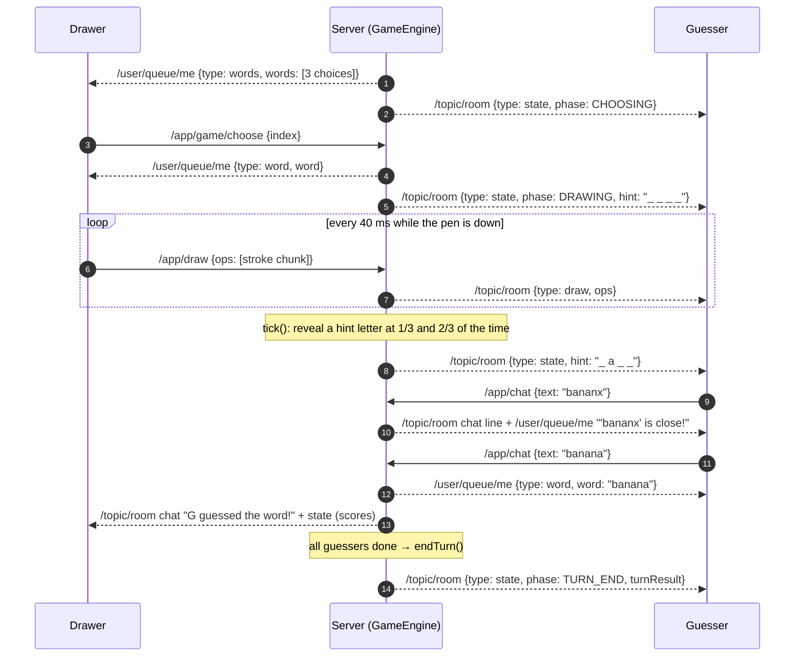

# Architecture

Scribbly is a multiplayer draw-and-guess game. A Spring Boot server holds every room in memory and runs the rules; a Vue 3 client renders the room and sends player actions. They talk over a single STOMP-over-SockJS WebSocket.

## System overview

### Backend packages

| Package | What lives there |
|---|---|
| `controller` | `GameWebSocketController`: one method per `/app/**` destination, plus the disconnect listener. No logic. |
| `service` | `GameEngine` (rules and state machine), `RoomManager` (room lookup, matchmaking, session → player binding), `GameBroadcaster` (all outbound messages), `WordBankService`. Pure helpers: `Hints`, `GuessChecker`, `Scoring`. |
| `model` | `GameRoom` (mutable room state), `Player`, `RoomSettings`, `DrawOp`, `ChatLine`, `TurnResult`, `RoomView` (public snapshot), `Requests` (inbound payloads), `Phase`. |
| `repository` | `GameRoomRepository` interface + in-memory implementation. A Redis/DB implementation can replace it without touching the engine. |
| `config` | `WebSocketConfig` (broker, ordering, inbound security filter), `GameProperties` (`game.*` settings). |

### Frontend modules

| File | Role |
|---|---|
| `src/ws/stompClient.js` | Opens one STOMP connection (`/ws`, proxied to `:8080` by Vite). |
| `src/game/store.js` | The single source of client state. `reduce(state, message)` is a pure function applying one server message; `enter()`, `leaveRoom()`, `send()` are the actions. |
| `src/game/render.js` | Pure canvas painting: strokes, dots, scanline flood fill. |
| `src/game/sound.js` | Synthesised sound cues (WebAudio, no files). |
| `src/views/HomeView.vue` | Name, avatar, quick play, private room, join by code or invite link. |
| `src/views/PlayView.vue` | Game layout and keyboard shortcuts. |
| `src/components/*` | `GameHeader` (clock, word/hint), `PlayerList`, `ChatBox`, `DrawingCanvas`, `DrawToolbar`, `BoardOverlay` (lobby, word choice, result, podium), `LobbySettings`, `Avatar`, `AvatarPicker`, `Doodle`. |

## Room state machine

Each room is one state machine. Player actions and the clock drive the transitions.

A *round* means every player draws once. The draw order is the join order at the start of the round. Players who join mid-round are added to the end of the current round's queue.

## One turn, end to end

## Key design decisions

**Identity comes from the connection, never the payload.** Every handler receives the STOMP session id (`simpSessionId`). `RoomManager` maps it to `(roomCode, playerId)`. The old protocol trusted `username`/`roomId` fields in the body, so any client could act as anyone.

**Two channels only.** `/topic/room/{code}` carries everything public. `/user/queue/me` carries what one player may see: their word choices, the secret word, close-guess whispers, errors. Every message is an envelope `{"type": ...}`, so the client has one subscription per channel and one `reduce()`.

**The inbound filter is a trust boundary.** The Spring simple broker would otherwise accept a client `SEND` to `/topic/**` (forged strokes or chat), or a `SUBSCRIBE` to another session's resolved queue (`/queue/me-user…`, which carries the word). `WebSocketConfig.isAllowed` lets clients send only to `/app/**` and subscribe only to `/user/queue/me` and `/topic/room/{code}`.

**Ordering is preserved both ways.** `setPreserveReceiveOrder(true)` handles a client's frames in send order (stroke chunks, then undo). `setPreservePublishOrder(true)` delivers a room's messages to each client in publish order. Without these, Spring's thread pools can reorder frames from the same session.

**One lock per room.** Every engine entry point resolves the room, then runs inside `synchronized (room)`. Rooms never share a lock, so busy rooms don't slow each other down. `GameRoom.players` is copy-on-write so matchmaking can read room sizes without locking.

**Time is a tick, not a timer per room.** `tickAll()` runs every 250 ms and moves rooms whose deadline has passed (choose timeout, hint reveal, end of drawing, next turn, back to lobby). The `Clock` is injected, so tests move time by hand instead of sleeping. The client gets `timeLeft` with each state and counts down locally, so there is no per-second timer broadcast.

**A fixed logical canvas.** The board is always 800×600 logical pixels and CSS scales it. Strokes are sent as compact polylines (`{t:'s', g, c, s, p:[x,y,…]}`) in 40 ms chunks; fills as `{t:'f', p:[x,y]}`. The server keeps the turn's op list, so late joiners get the full drawing, and undo/clear are a `sync` that replaces it. `g` groups one pen gesture so undo removes it as a unit.

**The server sanitises everything.** Names, chat (≤100 chars, no control characters), settings (clamped), draw ops (colour regex, coordinates clamped, ≤500 points, ≤6000 ops per turn), avatar indexes.

## What changed from v1.2

| v1.2 problem | Now |
|---|---|
| Rounds never ended on timeout (nobody called `/app/timer-ended`) | The server's tick ends turns itself |
| `@Async` self-call + `Thread.sleep(5000)` blocked a WebSocket thread | Deadline + tick; no sleeping |
| Canvas used each client's pixel size, so strokes landed in different places | Fixed 800×600 logical board |
| Remote strokes shared the local canvas path (`beginPath` once) | Each op paints its own path |
| Word options on `/topic/word-options/{username}`: anyone could subscribe | Private user queue + subscription filter |
| Usernames and room ids taken from the payload | Session-bound identity |
| Total rounds hard-coded to 3 and counted per drawer | Rounds = every player draws once, configurable |
| No disconnect handling, ghost players | `SessionDisconnectEvent` → leave, owner hand-off, turn/game end |
| Late joiners saw a blank canvas | `welcome` carries the full drawing |
| 11 of 12 tests failing | 35 backend + 12 frontend tests + browser e2e |

## Scaling notes

State is in memory, so one server process runs all rooms. To run several instances you would: put rooms in a shared store behind `GameRoomRepository` (e.g. Redis), switch the simple broker to a STOMP relay (RabbitMQ) via `enableStompBrokerRelay`, and pin each room's tick to one owner (e.g. a Redis lock). The engine code doesn't need to change for any of this.
