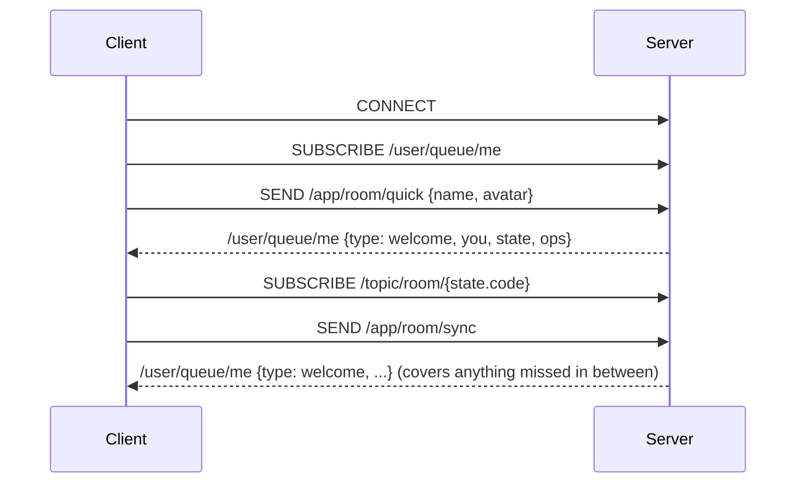

# WebSocket protocol

Transport: SockJS endpoint `/ws`, STOMP 1.2 on top. JSON bodies.

A client subscribes to its private queue first, joins a room, then subscribes to the room topic named in the `welcome` reply and sends `/app/room/sync` to get a fresh snapshot.



Clients may only `SEND` to `/app/**` and only `SUBSCRIBE` to `/user/queue/me` and `/topic/room/{CODE}`. The server silently drops anything else.

## Client → server

The sender is always identified by its connection. Nothing in a payload says who you are.

| Destination | Body | Who | Effect |
|---|---|---|---|
| `/app/room/quick` | `{name, avatar}` | anyone | Join the fullest public room with a free seat, or open a new one. A public room starts by itself at 2 players. |
| `/app/room/create` | `{name, avatar}` | anyone | Open a private room; you become its owner. |
| `/app/room/join` | `{name, avatar, code}` | anyone | Join a room by code (case-insensitive). Errors if it doesn't exist or is full. |
| `/app/room/leave` | `{}` | player | Leave. Closing the socket does the same. |
| `/app/room/sync` | `{}` | player | Re-send `welcome` to you. |
| `/app/room/settings` | `RoomSettings` | private-room owner, lobby only | Change settings. Values are clamped. |
| `/app/game/start` | `{}` | private-room owner, lobby only | Start (needs ≥ 2 players). |
| `/app/game/choose` | `{index}` | drawer, CHOOSING | Pick one of your word choices. |
| `/app/draw` | `{ops: DrawOp[]}` | drawer, DRAWING | Append ops and broadcast them. |
| `/app/draw/undo` | `{}` | drawer, DRAWING | Remove the newest pen gesture (all ops sharing its `g`). |
| `/app/draw/clear` | `{}` | drawer, DRAWING | Clear the board. |
| `/app/chat` | `{text}` | player | Chat or guess (≤ 100 chars). See rules below. |
| `/app/rate` | `{like: boolean}` | guesser, DRAWING | Like or dislike the drawing, once per turn. |
| `/app/kick/vote` | `{playerId}` | player | Vote to kick someone. |
| `/app/kick` | `{playerId}` | private-room owner | Kick immediately. |

`avatar` is `{color, eyes, mouth}`: integers, wrapped by the client.

## Server → client

### `/topic/room/{code}` (everyone in the room)

| `type` | Fields | Meaning |
|---|---|---|
| `state` | `state: RoomView` | Room snapshot. Sent on every change. |
| `chat` | `line: ChatLine` | A public chat line. |
| `draw` | `ops: DrawOp[]` | New ops to paint on top. The drawer ignores these (already painted locally). |
| `sync` | `ops: DrawOp[]` | Replace the whole drawing (new turn, undo, clear). |

### `/user/queue/me` (only you)

| `type` | Fields | Meaning |
|---|---|---|
| `welcome` | `you`, `state`, `ops`, `word?`, `words?` | Full snapshot after joining or `room/sync`. `word` if you're drawing or already guessed; `words` if you're choosing. |
| `words` | `words: string[]` | Your word choices (you're the drawer). |
| `word` | `word` | The secret word: you're drawing, or you just guessed it. |
| `chat` | `line: ChatLine` | A line only you see: close-guess whisper, guessed-players chat, warnings. |
| `kicked` | | You were removed from the room. |
| `error` | `message` | Something you asked for failed (room full, wrong code, need 2 players…). |

## Types

```ts
type Phase = 'LOBBY' | 'CHOOSING' | 'DRAWING' | 'TURN_END' | 'GAME_OVER';

interface RoomView {
  code: string;              // 6 chars, no 0/O/1/I
  isPrivate: boolean;
  ownerId: string;
  phase: Phase;
  settings: RoomSettings;
  round: number;             // 1-based; 0 before the first round
  drawerId: string | null;
  hint: string | null;       // DRAWING only: "_a__ ___", letters revealed so far
  timeLeft: number;          // seconds left in this phase
  players: Player[];         // join order
  turnResult: TurnResult | null;  // TURN_END only
}

interface Player { id: string; name: string; avatar: Avatar; score: number; guessed: boolean; }

interface RoomSettings {
  maxPlayers: number;        // 2..12
  rounds: number;            // 1..10
  drawTime: number;          // seconds, 15..240
  wordCount: number;         // choices offered, 1..5
  hints: number;             // 0..5, capped at half the letters
  customWords: string[];     // ≤ 500, each ≤ 30 chars
  customOnly: boolean;       // only custom words (if there are enough)
}

interface TurnResult { word: string | null; gains: Record<string, number>; reason: string; }

interface ChatLine {
  kind: 'chat' | 'guessed' | 'system' | 'success' | 'warn' | 'close';
  playerId?: string; name?: string; text: string;
}

// 800x600 logical board
type DrawOp =
  | { t: 's'; g: number; c: string; s: number; p: number[] }  // stroke: polyline [x0,y0,x1,y1,...], size s
  | { t: 'f'; g: number; c: string; s: number; p: [number, number] };  // flood fill at (x, y)
```

### Chat routing during DRAWING

| Sender | Message | Who sees it |
|---|---|---|
| Guesser | the word (case, spaces and punctuation ignored) | Nobody. Everyone gets "X guessed the word!", the sender gets the word privately. |
| Guesser | one typo away (≥ 4 letters) | Everyone sees the message; the sender also gets "'…' is close!". |
| Guesser | anything else | Everyone. |
| Drawer or someone who guessed | anything not containing the word | Only the drawer and players who guessed (`kind: guessed`). |
| Drawer | contains the word | Nobody; the drawer gets a warning. |
